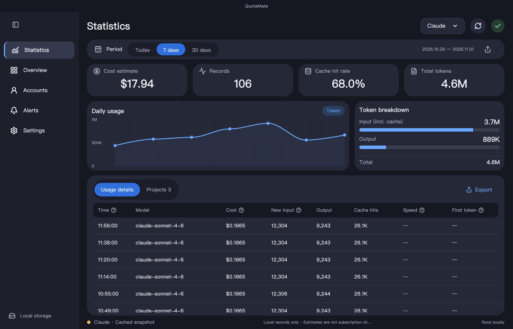
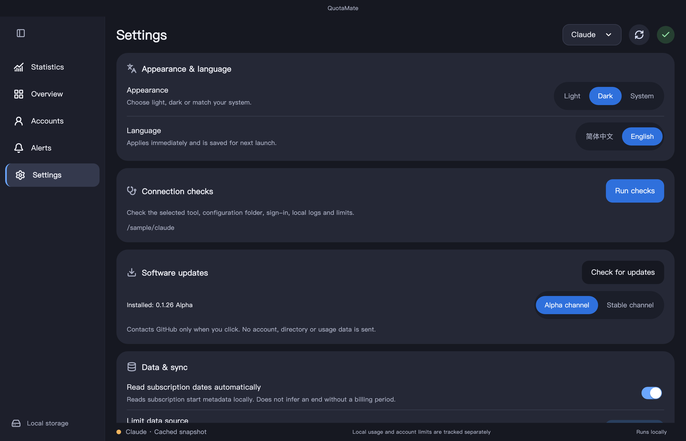

<p align="center"></p>
<h1 align="center">QuotaMate</h1>
<p align="center"><strong>Your local AI usage, clearly.</strong></p>
<p align="center">A macOS and Windows dashboard for GPT / Codex and Claude Code usage, cache, and reference costs.</p>
<p align="center">
  <a href="https://github.com/liuzilong200049-bot/QuotaMate/actions/workflows/ci.yml"></a>
  
  
  <a href="LICENSE"></a>
</p>
<p align="center"><a href="https://github.com/liuzilong200049-bot/QuotaMate/releases/download/v0.1.30-alpha/QuotaMate-0.1.30-macos-universal.dmg"></a> <a href="https://github.com/liuzilong200049-bot/QuotaMate/releases/download/v0.1.30-alpha/QuotaMate-0.1.30-windows-x64-setup.exe"></a></p>
<p align="center"><a href="#download">Download</a> · <a href="#first-run">First run</a> · <a href="#connect-gpt">GPT / Codex</a> · <a href="#connect-claude">Claude</a> · <a href="#faq">FAQ</a> · <a href="README.md">简体中文</a></p>



All previews use production Flutter components with synthetic accounts, fictional paths, and fake usage. They are not evidence of a real account connection. The app starts on Today; previews can use the seven-day range to show a fuller trend.

## What you can see

| Quota | Usage | Everyday controls |
| --- | --- | --- |
| GPT subscription windows and resets; existing local Claude limit snapshots | Input/output/cache tokens, projects, records, and estimated API-equivalent costs | Today / 7 days / 30 days, CSV export, English / Chinese, and light / dark / system themes |

> [!IMPORTANT]
> QuotaMate reads supported **local records**. It does not synchronize the full token history of regular ChatGPT or Claude web/desktop chat, and it does not provide model chat. Claude uses passive local collection, not subscription-limit polling.

<a id="download"></a>

## Download and install

**v0.1.30 Alpha · macOS 12+ universal / Windows x64.** The original Codex / Claude tools may have higher system requirements.

Click the macOS menu bar hourglass or Windows tray icon to see remaining quota, reset times and today’s usage.

| Package | Use | Direct link |
| --- | --- | --- |
| **Windows x64 installer** | Install for the current user | **[Download EXE](https://github.com/liuzilong200049-bot/QuotaMate/releases/download/v0.1.30-alpha/QuotaMate-0.1.30-windows-x64-setup.exe)** |
| Windows x64 portable ZIP | Extract the complete folder, then run quota_mate.exe | [Download ZIP](https://github.com/liuzilong200049-bot/QuotaMate/releases/download/v0.1.30-alpha/QuotaMate-0.1.30-windows-x64.zip) |
| Windows SHA256 | Verify Windows downloads | [Checksums](https://github.com/liuzilong200049-bot/QuotaMate/releases/download/v0.1.30-alpha/SHA256SUMS-windows) |
| **DMG** | Recommended for most users | **[Download DMG](https://github.com/liuzilong200049-bot/QuotaMate/releases/download/v0.1.30-alpha/QuotaMate-0.1.30-macos-universal.dmg)** |
| ZIP | Extract and move the app manually | [Download ZIP](https://github.com/liuzilong200049-bot/QuotaMate/releases/download/v0.1.30-alpha/QuotaMate-0.1.30-macos-universal.zip) |
| SHA256 checksums | Verify file consistency | [Download SHA256SUMS](https://github.com/liuzilong200049-bot/QuotaMate/releases/download/v0.1.30-alpha/SHA256SUMS) |
| Release notes | Changes and limitations | [View release](https://github.com/liuzilong200049-bot/QuotaMate/releases/tag/v0.1.30-alpha) |

**Windows:** use the installer, or extract the complete ZIP and run `quota_mate.exe`. Native Windows clients are the first target; WSL is separate. [Windows guide](docs/windows.md).

**macOS:**

1. Download and open the DMG.
2. Drag **QuotaMate** into **Applications**.
3. Open it from Applications. Quit an older version before replacing it.
4. Select your provider and follow the connection steps below.

> [!NOTE]
> This is an ad-hoc signed **Alpha development build**, not Apple Developer ID signed or notarized. If macOS cannot verify the developer, verify the source and integrity first. If you trust the app and choose to proceed, follow [Apple's official instructions](https://support.apple.com/en-us/102445) for **System Settings → Privacy & Security → Open Anyway** after trying to open it. Do not treat malware or damaged-file alerts as ordinary developer warnings. Windows x64 is an unsigned Alpha; Linux releases are not available. See the [Windows guide](docs/windows.md).

No Flutter, Python, or API key is needed to install QuotaMate. Install the original Codex / Claude Code tools separately. A checksum checks consistency, not notarization or safety.

<a id="first-run"></a>

## First run

**New in v0.1.26:** step-by-step connection checks, manual Alpha/stable release discovery, and optional Windows tray/startup behavior with single-instance activation. Automatic version checks can be disabled in Settings. [Connection and update guide](docs/connection-checks.md).

| Step | Action | Result |
| --- | --- | --- |
| **1. Choose a provider** | Select GPT or Claude at the top right | Independent sources and statistics |
| **2. Check the connection** | Open Accounts; set the source directory or executable in Settings if needed | Account information and data provenance |
| **3. Use your original tool normally** | Continue working in Codex / terminal Claude Code | New local usage logs |
| **4. Refresh and choose a period** | Select Today, 7 days, or 30 days | Usage records, projects, trends, and reference costs |

Signing in does not create token history. If Today is empty, check other periods and whether this source has supported local records.

<a id="connect-gpt"></a>

### Connect GPT / Codex

1. Install and sign in to the official [Codex CLI](https://learn.chatgpt.com/docs/cli), or a supported local tool bundled with the [ChatGPT / Codex desktop app](https://learn.chatgpt.com/docs/app).
2. Select **GPT**, refresh, and confirm the email and subscription shown under **Accounts**.
3. The default source is `~/.codex`. For another source, use **Settings → Codex data directory → Choose folder**, selecting the configuration root containing `sessions` or `archived_sessions`.
4. If discovery fails, use **Settings → Codex executable → Choose executable**. In a macOS file dialog, **⌘⇧G** can navigate to a hidden directory.

Limits belong to the selected official tool configuration. Switching accounts independently in the desktop app may not switch that configuration. API key mode supports compatible local usage records but not subscription remaining percentages.

If available, **Reset quota** consumes one reset credit when you click it. Background refresh does not automatically consume reset credits.

<a id="connect-claude"></a>

### Connect Claude Code

1. Install terminal Claude Code using the [official quickstart](https://code.claude.com/docs/en/quickstart). Regular desktop chat alone does not provide the terminal log source.
2. Select **Claude**, then open **Settings → Claude connection**.
3. Choose **Sign in** and finish authentication in the official terminal/browser. After completion, use **Read local data**. QuotaMate does not ask you to supply a subscription token, Cookie, or authorization code.
4. For local token statistics, the default source is `~/.claude`, whose `projects` folder contains the supported terminal logs.
5. For limit snapshots, explicitly enable **Status line collection** in Settings, then start a new terminal Claude Code session and use it normally. Read local data again after a snapshot is available.



Collection preserves your original status line and can restore it when disabled. Snapshots retain their timestamps; refreshing does not turn old data into live data. Missing, expired, or identity-mismatched limits remain unknown. Desktop Code, Cowork, remote sessions, and other devices are not fully covered. Rebind status line collection after an account change.

## Automatic subscription dates

**Settings → Read subscription dates automatically** is on by default; no manual date entry is needed.

- **GPT / Codex:** locally parses the selected official sign-in cache for subscription start, period-end, and last-checked dates. The UI labels the end as **Period ends · cache**. It is cached metadata, not a live billing confirmation or proof that renewal stops.
- **Claude:** reads the subscription creation date from its ordinary local configuration and labels it **Started · local**. No monthly/yearly period or end is invented.
- This feature makes no billing/subscription request and never uses a cached token for network requests. Raw credentials are not copied into the QuotaMate database, logged, or uploaded. Turn the setting off to stop reading and showing this extra metadata.

Cached fields may be missing or change format. Account identity is checked, and an old period-end date never overrides the official tool's current plan or reset permissions. See [date provenance](docs/subscriptions.md#自动日期来源).

## Built-in reference prices

**No manual price entry is needed for the included models.** A fresh install automatically loads 20 Claude model prices and the existing 5 GPT prices. Input, cache reads, output and Claude cache writes are covered. Haiku 5.5 selects its longer-prompt rate per record.

Upgrades preserve same-name custom prices and previously removed models. Rates are USD per million tokens, not actual subscription charges. [Claude default table](docs/claude-reference-pricing.md) · [Existing GPT defaults](docs/reference-pricing.md)

## Understand the numbers

| Field | Meaning |
| --- | --- |
| Cost estimate | API-reference-price calculation, not an actual subscription charge |
| Total tokens | Input plus output within the selected period; cache is already part of input |
| Cache hit rate | Cache-read tokens divided by input tokens, excluding output |
| Records | Local records carrying usage, not confirmed billable HTTP requests |
| Speed / first token | Shown when supported; `≈` means estimated, `—` means unavailable |
| Snapshot remaining | Limit at collection time, not a live query |

Choose **Projects** to group usage, or **Export** for a CSV. Theme and language are under **Settings → Appearance & language** and persist across launches. [Detailed accounting](docs/data-sources.md)

<a id="faq"></a>

## FAQ

<details>
<summary><strong>Why is usage empty after signing in?</strong></summary>

Account status, quota, and token history are separate data sources. Check the provider, selected period, source directory, and whether **Summarize local usage** is enabled under Accounts. Regular web/desktop chat, remote tasks, and other devices do not automatically become local records. Old records may be outside every available period.

</details>

<details>
<summary><strong>Why is Claude connected but showing no limits?</strong></summary>

Claude subscription polling is removed. Existing identity-matched snapshots are required. Optional status line collection targets new terminal sessions and does not guarantee data from desktop chat, the Code tab, or Cowork. Signing in alone cannot fill missing snapshots. [Claude data source](docs/claude-connection.md)

</details>

<details>
<summary><strong>Why is an old account or timestamp shown?</strong></summary>

Confirm the selected configuration and its official tool login. Local history is not automatically owned by the current email. Snapshots keep their original collection time, and unsupported fields such as subscription expiry remain unknown.

</details>

<details>
<summary><strong>Does this upload conversations or guarantee my account is safe?</strong></summary>

QuotaMate has no cloud backend or telemetry endpoint of its own. The app database does not store conversation bodies, model replies, tool arguments, or OAuth credentials; official CLIs may contact their providers. The project cannot guarantee account safety or imply provider authorization. See [Security](SECURITY.md) for storage and reporting details.

</details>

<details>
<summary><strong>How do I update or uninstall?</strong></summary>

Quit QuotaMate before replacing it with a new version. Local data lives in `~/Library/Application Support/QuotaMate/usage.sqlite3`. Before uninstalling, disable Claude status line collection if enabled, then quit and remove the app. Removing the app does not automatically remove your database or exported CSV files.

</details>

## Help and development

[Detailed walkthrough (中文)](docs/quick-start.md) · [Report a problem](https://github.com/liuzilong200049-bot/QuotaMate/issues/new/choose) · [Private security report](https://github.com/liuzilong200049-bot/QuotaMate/security/advisories/new)

Remove personal information from reports. Do not upload raw logs, databases, credentials, or screenshots showing real account details.

<details>
<summary><strong>Build, test, and package from source</strong></summary>

Baseline: Flutter **3.47.7** / Dart **3.13.5**, macOS, Xcode. Python 3 is only for development and release checks.

```sh
git clone https://github.com/liuzilong200049-bot/QuotaMate.git
cd QuotaMate
flutter pub get --enforce-lockfile
flutter run -d macos
```

```sh
dart format --output=none --set-exit-if-changed lib test tool
dart analyze
flutter test
python3 -m unittest discover -s scripts -p 'test_*.py'
python3 scripts/check_public_files.py
bash scripts/package_macos.sh
```

The public-file check reads the Git index; stage intended public files first. See [CONTRIBUTING.md](CONTRIBUTING.md) for native relay tests and contribution guidelines. CI uses synthetic data and never runs real-account diagnostics. The package script builds the relay, produces DMG / ZIP / checksums in `dist/`, then moves verified older local installers to Trash.

</details>

## License and credits

[MIT](LICENSE) for the project's own code and resources. [Third-party notices](THIRD_PARTY_NOTICES.md) · [Changelog](CHANGELOG.md) · [Artwork provenance](docs/branding.md)

UI styling was inspired by FlClash without importing its UI source or proxy engine. Timing logic references CC Switch with its MIT notice retained. This independent project is not affiliated with or endorsed by OpenAI, Anthropic, or FlClash.
