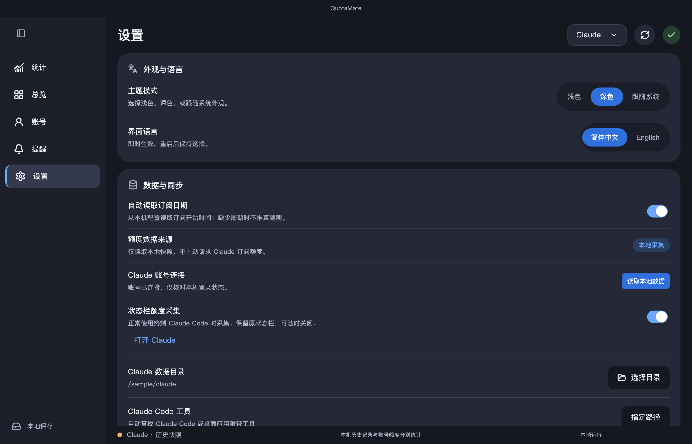
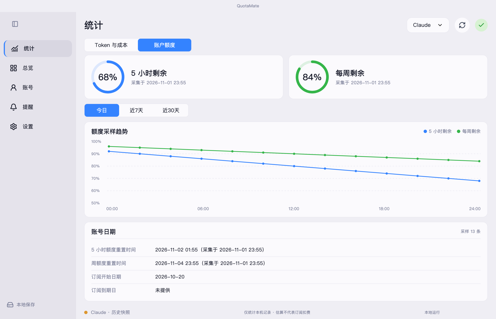
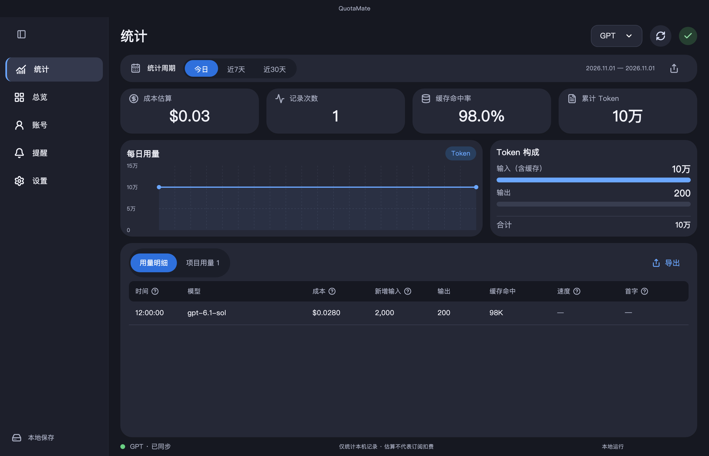
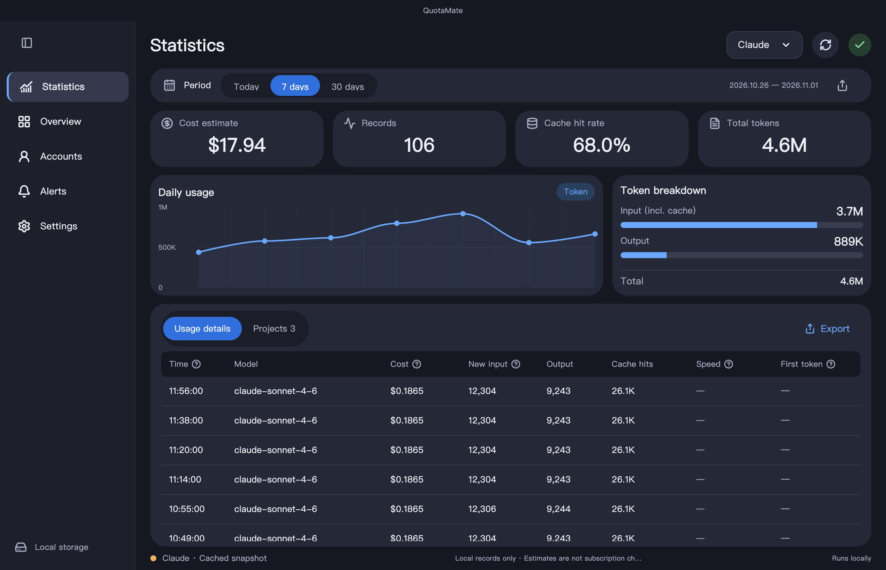

<p align="center">
  
</p>
<h1 align="center">QuotaMate</h1>
<p align="center"><strong>用量、缓存、参考成本，一眼看清。</strong></p>
<p align="center">适用于 macOS / Windows 的 GPT、Codex 与 Claude Code 本机用量面板。</p>
<p align="center">
  <a href="https://github.com/liuzilong200049-bot/QuotaMate/actions/workflows/ci.yml"></a>
  
  
  
  <a href="LICENSE"></a>
</p>
<p align="center">
  <a href="https://github.com/liuzilong200049-bot/QuotaMate/releases/download/v0.1.30-alpha/QuotaMate-0.1.30-macos-universal.dmg"></a>
  <a href="https://github.com/liuzilong200049-bot/QuotaMate/releases/download/v0.1.30-alpha/QuotaMate-0.1.30-windows-x64-setup.exe"></a>
</p>
<p align="center">
  <a href="#download">下载安装</a> · <a href="#first-run">第一次使用</a> · <a href="#connect-gpt">连接 GPT</a> · <a href="#connect-claude">连接 Claude</a> · <a href="#faq">常见问题</a> · <a href="README.en.md">English</a>
</p>

<picture>
  <source media="(prefers-color-scheme: dark)" srcset="screenshots/preview/overview-gpt-dark-zh.png">
  <source media="(prefers-color-scheme: light)" srcset="screenshots/preview/overview-gpt-light-zh.png">
  
</picture>
<p align="center"><sub>生产组件使用合成账号与七天示例数据渲染；不包含真实账号或对话。应用启动默认显示今日。</sub></p>

## 你可以用它做什么

| 看清额度 | 了解用量 | 管理习惯 |
| --- | --- | --- |
| GPT 订阅窗口、恢复时间；Claude 已采集的本地额度快照 | 输入 / 输出 / 缓存 Token、项目汇总、逐条记录和参考成本 | 今日 / 近 7 天 / 近 30 天，中英文、明暗主题和 CSV 导出 |

> [!IMPORTANT]
> **QuotaMate 统计的是支持的本机记录。** 它不会把 ChatGPT 或 Claude 网页、普通桌面聊天的全部历史同步进来；也不提供模型对话服务。Claude 当前采用本地被动采集，不主动轮询订阅额度接口。

<a id="download"></a>

## 下载安装

**当前版本：v0.1.30 Alpha · macOS 12+ 通用版 / Windows x64。** 原工具另有系统要求时，以其官方说明为准。

单击 macOS 菜单栏的沙漏或 Windows 托盘图标，即可查看剩余额度、重置时间和今日用量。

| 下载项 | 适合谁 | 链接 |
| --- | --- | --- |
| **Windows x64 安装程序** | Windows 用户，安装到当前用户目录 | **[直接下载 EXE](https://github.com/liuzilong200049-bot/QuotaMate/releases/download/v0.1.30-alpha/QuotaMate-0.1.30-windows-x64-setup.exe)** |
| Windows x64 便携 ZIP | 全部解压后启动，无需安装 | [下载 Windows ZIP](https://github.com/liuzilong200049-bot/QuotaMate/releases/download/v0.1.30-alpha/QuotaMate-0.1.30-windows-x64.zip) |
| Windows SHA256 | 校验 Windows 下载文件 | [下载校验文件](https://github.com/liuzilong200049-bot/QuotaMate/releases/download/v0.1.30-alpha/SHA256SUMS-windows) |
| **DMG 安装包** | 大多数 Mac 用户，推荐 | **[点击直接下载 DMG](https://github.com/liuzilong200049-bot/QuotaMate/releases/download/v0.1.30-alpha/QuotaMate-0.1.30-macos-universal.dmg)** |
| ZIP 压缩包 | 希望解压后手动放入应用程序 | [直接下载 ZIP](https://github.com/liuzilong200049-bot/QuotaMate/releases/download/v0.1.30-alpha/QuotaMate-0.1.30-macos-universal.zip) |
| SHA256 校验文件 | 检查下载是否完整 | [下载校验文件](https://github.com/liuzilong200049-bot/QuotaMate/releases/download/v0.1.30-alpha/SHA256SUMS) |
| 版本说明 | 查看更新内容与已知限制 | [打开 Release 页面](https://github.com/liuzilong200049-bot/QuotaMate/releases/tag/v0.1.30-alpha) |

**Windows：** 下载 EXE 按向导安装，或完整解压 ZIP 后运行 `quota_mate.exe`。[Windows 安装、连接、快捷键与排错 →](docs/windows.md)

**macOS：**

1. 下载并双击打开 **DMG**。
2. 将 **QuotaMate** 拖入窗口中的 **Applications / 应用程序** 文件夹。
3. 从「应用程序」打开 QuotaMate；更新时请先退出旧版，再替换原应用。
4. 首次使用按下面的步骤选择数据源，正常使用原工具后刷新。

> [!NOTE]
> 这是 **Alpha 开发测试包**，尚无 Apple Developer ID 签名及公证。若系统提示无法验证开发者，请先查看 [首次打开说明](docs/quick-start.md#macos-first-open)，再决定是否试用。Windows 首版为未签名 Alpha，真实客户端与设备兼容性欢迎反馈；Linux 暂无发行版。

<a id="first-run"></a>

## 第一次使用

**v0.1.26 新增：** [逐项连接诊断、手动检查更新](docs/connection-checks.md)，以及 Windows 可选关闭到托盘、登录启动和单实例唤回。可在设置管理版本检查和登录启动。

**安装 QuotaMate 不需要 Flutter、Python 或 API Key。** 需要在本机已有对应的官方 Codex / Claude Code 工具；查看旧日志不要求当前登录。

| 步骤 | 在哪里操作 | 你会看到什么 |
| --- | --- | --- |
| **① 选择平台** | 窗口右上角选择 **GPT** 或 **Claude** | 两个平台分别显示，不会混在一起 |
| **② 核对连接** | 打开左侧 **账号**，必要时在 **设置** 指定工具与数据目录 | 当前工具的登录信息、数据来源和快照状态 |
| **③ 正常使用原工具** | 在 Codex / Claude Code 中继续原本的工作 | 原工具产生本机用量日志 |
| **④ 回来查看统计** | 点击右上角刷新，再选择 **今日 / 近7天 / 近30天** | 用量明细、趋势、项目汇总及参考成本 |

**安装后仍是空白？** 先看时间范围，再看所选目录是否存在本机记录。仅登录账号不会生成 Token 历史。[查看逐步排查方法 →](docs/quick-start.md#empty-statistics)

<a id="connect-gpt"></a>

### 连接 GPT / Codex

1. 安装并登录官方 [Codex CLI](https://learn.chatgpt.com/docs/cli)，或本机包含 Codex 工具的 [ChatGPT / Codex 桌面应用](https://learn.chatgpt.com/docs/app)。
2. 在 QuotaMate 右上角选 **GPT**，点击刷新，并在 **账号** 页核对邮箱与订阅等级。
3. 默认读取 `~/.codex`；使用其他配置目录时，在 **设置 → Codex 数据目录 → 选择目录** 中选择配置根目录。
4. 提示未找到工具时，进入 **设置 → Codex 工具 → 指定路径**，选择已安装的可执行文件。

额度反映所选 Codex 配置目录对应的官方工具账号。桌面应用独立切换的账号可能不同；本机历史也不强行归属于当前登录邮箱。[完整连接步骤与成功标志 →](docs/quick-start.md#connect-gpt)

<a id="connect-claude"></a>

### 连接 Claude Code

1. 按 [官方快速开始](https://code.claude.com/docs/en/quickstart) 安装 Claude Code；在 QuotaMate 右上角选 **Claude**。
2. 在 **设置 → Claude 账号连接** 点击 **登录 Claude Code**，通过打开的官方终端和浏览器完成登录；已登录时点击 **读取本地数据**。
3. 要显示额度快照，在 **设置 → 状态栏额度采集** 主动开启采集，再在**新开的终端 Claude Code 会话**中正常使用，之后回到 QuotaMate 读取。
4. 默认日志目录为 `~/.claude`。采集会保留原状态栏输出，关闭可恢复原设置。

**Claude 的 Token 统计来自本机终端日志，额度来自已有快照。** 普通网页 / 桌面聊天没有逐请求 Token 明细；桌面 Code、Cowork 和远程会话尚未完整适配。[完整设置、限制与排查 →](docs/quick-start.md#connect-claude)

<details>
<summary><strong>展开查看 Claude 设置与连接诊断</strong></summary>



示例路径为虚构目录。请在自己的软件中核对实际设置，不要把别人的目录或账号信息复制进去。

</details>

## 自动显示订阅日期

默认开启 **设置 → 自动读取订阅日期**，不需要手工填写：

- **GPT / Codex：** 在本机解析所选配置的登录缓存，仅提取订阅开始、周期结束和元数据核对日期。界面标为 **订阅周期（缓存）**；缓存可能滞后，周期结束不表示自动续费一定停止。
- **Claude：** 从本机普通配置读取 **订阅开始（本机）**。未提供月付 / 年付周期和结束日时，不按一个月猜到期。
- 日期读取不调用账单或订阅接口，不拿凭证发请求；原始令牌不会写入 QuotaMate 数据库、日志或上传。关闭开关后不再读取或展示这份额外元数据。

本机缓存字段不是稳定的官方账单接口。缺失、身份不匹配或格式变化时仍显示未知；账号等级与重置权限以官方工具结果为准，不会因旧缓存日期已过就自动降级。[日期来源与隐私说明](docs/subscriptions.md#自动日期来源)

## 内置默认单价

**安装后无需逐个填写价格。** 新用户首次启动会自动带入 Claude 20 个型号和 GPT 原有 5 个型号的参考价，包含输入、缓存读取、输出与 Claude 缓存写入估算。Haiku 5.5 的长提示档位按每条记录自动选择。

升级保留同名手动价格和已删除的旧条目。价格采用美元 / 百万 Token，不代表订阅实际扣费。[查看 Claude 完整默认表](docs/claude-reference-pricing.md) · [GPT 原有默认表](docs/reference-pricing.md)

Claude 统计默认打开「账户额度」，按所选日期范围显示账号已核对的额度采样。切换「Token 与成本」查看 Code 用量。空白时可查看最近有记录的一天，部分型号缺少价格时显示已计价小计和覆盖条数。

<details>
<summary>查看 Claude 账户额度界面</summary>



</details>

## 看懂你的统计



| 字段 | 含义 |
| --- | --- |
| **成本估算 / 等价估算** | 按配置的 API 参考单价折算，不是订阅实际扣费 |
| **累计 Token** | 当前时间范围的输入与输出总量；缓存已包含在输入中 |
| **缓存命中率** | 缓存命中 Token ÷ 输入 Token，不包含输出 |
| **记录次数** | 本机含用量的记录数，不等同于官方结算请求数 |
| **速度 / 首字** | 有可靠字段时显示；`≈` 表示估算，缺失时显示 `—` |
| **快照剩余** | 采集时刻的额度，需结合来源和时间查看，不代表实时查询 |

点击 **项目用量** 可查看项目汇总；点击 **导出** 保存当前范围的 CSV。[详细统计口径 →](docs/data-sources.md)

<details>
<summary><strong>浅色、深色与英文界面</strong></summary>

主题和语言在 **设置 → 外观与语言** 中即时切换，并在下次启动保留。




</details>

<a id="faq"></a>

## 常见问题

<details>
<summary><strong>已经登录，为什么统计还是 0？</strong></summary>

账号登录、订阅额度和本机 Token 历史是三种不同的数据。先切换 **近7天 / 近30天**，再核对日志目录和记录是否来自支持的客户端。旧记录可能不在当前范围内。网页或其他设备的用量不会因登录自动补齐。[完整排查](docs/quick-start.md#empty-statistics)

</details>

<details>
<summary><strong>Claude 已连接，为什么仍没有额度？</strong></summary>

当前不主动请求 Claude 订阅额度。只有身份匹配的本地状态栏 / 桌面快照可供显示；缺少、过期或无法确认身份时保持未知。终端状态栏采集需主动开启，并在正常的新终端会话中产生快照。普通桌面聊天不保证产生它。[Claude 数据来源](docs/claude-connection.md)

</details>

<details>
<summary><strong>显示旧账号、旧时间，或者“接口未提供”？</strong></summary>

账号来自所选配置目录的官方工具登录；桌面切换账号不一定同步该目录。先核对数据源，再在官方工具中确认登录并刷新。快照保留原始时间，刷新不会把旧样本“变新”；接口或本机元数据未提供日期、窗口或计时时，不会猜测数值。

</details>

<details>
<summary><strong>会上传聊天内容吗？会自动消耗重置次数吗？</strong></summary>

QuotaMate 没有自己的云端服务或遥测端点，不把对话正文、模型回答、工具参数或 OAuth 凭证保存到应用数据库。官方 CLI 仍可能按其自身行为访问服务商。GPT 的重置权益仅在用户有可用次数并点击 **重置额度** 后消耗一次，后台刷新不会自动消耗。[隐私与存储](SECURITY.md)

</details>

<details>
<summary><strong>是否保证不封号？</strong></summary>

不能保证。软件是独立开源项目，不代表服务商授权或背书。Claude 已移除主动订阅轮询，也不提取订阅令牌或代理模型请求；使用原工具仍应遵守服务商条款。[使用边界](docs/claude-connection.md)

</details>

<details>
<summary><strong>支持 Windows、Intel Mac 或 API Key 模式吗？</strong></summary>

当前 macOS 通用包支持 Apple Silicon 和 Intel；原工具的系统与芯片要求另行适用。Windows x64 已提供 Alpha 安装程序及便携 ZIP，[使用指南](docs/windows.md)；首版优先 Windows 原生客户端，不自动接入 WSL。Linux 暂无发行版。API Key 模式可统计支持的本机日志，但不提供订阅剩余百分比。

</details>

## 需要帮助

- **刚装好不会用：** [Mac 图文快速上手](docs/quick-start.md) · [Windows 使用指南](docs/windows.md)
- **数据对不上：** [统计口径](docs/data-sources.md) · [Claude 连接](docs/claude-connection.md)
- **发现问题或希望新增功能：** [提交 Issue](https://github.com/liuzilong200049-bot/QuotaMate/issues/new/choose)，请附脱敏截图与复现步骤。
- **发现安全漏洞：** [私密报告](https://github.com/liuzilong200049-bot/QuotaMate/security/advisories/new)，不要公开上传凭证、数据库或原始日志。

## 参与开发

<details>
<summary><strong>从源码运行、测试和打包</strong></summary>

基准环境为 Flutter **3.47.7** / Dart **3.13.5**；macOS 使用 Xcode，Windows 使用 Visual Studio C++。[Windows 构建步骤](docs/windows.md#从源码构建)。Python 3 仅用于开发检查和打包，不是安装包的运行依赖。

```sh
git clone https://github.com/liuzilong200049-bot/QuotaMate.git
cd QuotaMate
flutter pub get --enforce-lockfile
flutter run -d macos
```

```sh
dart format --output=none --set-exit-if-changed lib test tool
dart analyze
flutter test
python3 -m unittest discover -s scripts -p 'test_*.py'
python3 scripts/check_public_files.py
bash scripts/package_macos.sh
```

公开文件检查读取 Git 索引；先暂存计划公开的文件再执行。原生采集器测试和贡献规范见 [CONTRIBUTING.md](CONTRIBUTING.md)。CI 使用模拟数据，不运行真实账号诊断。

`dist/` 包含 DMG、ZIP 与 SHA256。新包校验通过后，脚本把本机旧安装包移至废纸篓，只保留最新版本；失败时保留旧包。开发运行尚未构建原生转发器时，状态栏采集会提示组件不可用；完整打包脚本会构建它。

</details>

## 开源与致谢

项目自有代码与资源采用 [MIT](LICENSE)，依赖保留各自许可。[第三方声明](THIRD_PARTY_NOTICES.md) · [版本记录](CHANGELOG.md) · [品牌资源](docs/branding.md)

视觉风格参考 [FlClash](https://github.com/chen08209/FlClash)，日志计时参考 [CC Switch](https://github.com/farion1231/cc-switch) 并保留 MIT 声明；未引入 FlClash 的界面源码或代理内核。QuotaMate 与 OpenAI、Anthropic、FlClash 无官方隶属或背书关系。

<p align="center"><a href="https://github.com/liuzilong200049-bot/QuotaMate/releases/download/v0.1.30-alpha/QuotaMate-0.1.30-macos-universal.dmg"><strong>下载 QuotaMate for macOS →</strong></a></p>
