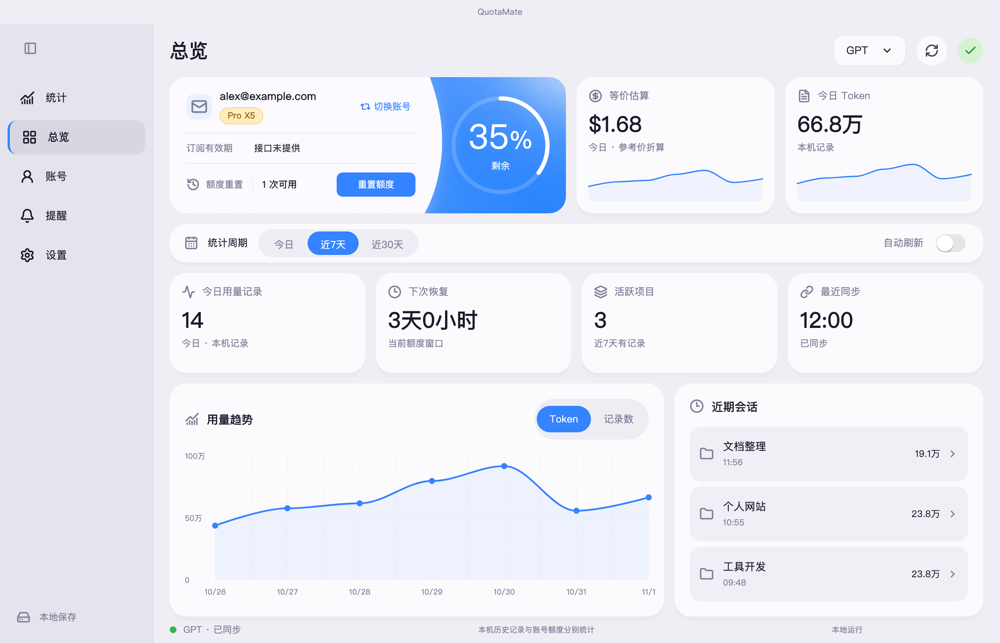
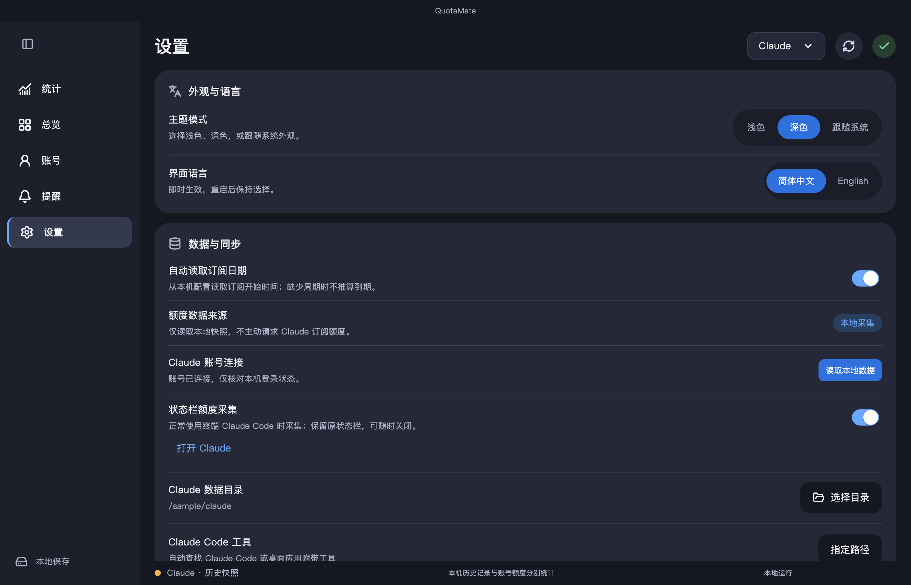

# QuotaMate 图文快速上手

**Windows 用户请先看 [Windows 使用指南](windows.md)。以下安装步骤适用于 macOS。**

[返回项目首页](../README.md) · [直接下载 macOS DMG](https://github.com/liuzilong200049-bot/QuotaMate/releases/download/v0.1.29-alpha/QuotaMate-0.1.29-macos-universal.dmg) · [版本说明](https://github.com/liuzilong200049-bot/QuotaMate/releases/tag/v0.1.29-alpha)

这份指南面向第一次安装的用户。QuotaMate 用于整理支持的本机 AI 用量，不提供模型对话，也不会因登录就同步所有云端聊天历史。

## 先确认是否适合你

| 你的使用方式 | 当前能看到什么 |
| --- | --- |
| 在这台 Mac 使用 Codex CLI，或产生兼容本机日志的 Codex 客户端 | 本机用量、项目与参考成本；官方工具已登录且提供接口时可读取订阅额度 |
| 在这台 Mac 使用终端 Claude Code | 本机 Token 统计；主动开启状态栏采集后可读取已有额度快照 |
| 只使用 ChatGPT / Claude 网页或普通桌面聊天 | 不会自动得到这些聊天的逐请求 Token 明细 |
| 使用桌面 Code、Cowork、远程任务或其他设备 | 当前没有完整覆盖；只能显示这台电脑存在的兼容记录 |

**安装包要求 macOS 12+，Intel 和 Apple Silicon 用同一个包。** Codex / Claude Code 自身可能要求更新的系统；Claude Code 的当前官方要求见 [系统要求](https://code.claude.com/docs/en/setup#system-requirements)。安装 QuotaMate 不需要 Flutter 或 Python，也不用把 API Key 填进 QuotaMate。

<a id="download"></a>

## 下载与安装

1. 点击 **[直接下载 DMG](https://github.com/liuzilong200049-bot/QuotaMate/releases/download/v0.1.29-alpha/QuotaMate-0.1.29-macos-universal.dmg)**，保存到下载文件夹。
2. 双击打开 DMG，将 **QuotaMate** 拖到 **Applications / 应用程序**。
3. 从「应用程序」启动；若已安装旧版，先退出旧版再替换。
4. 不想使用 DMG 时，可 [下载 ZIP](https://github.com/liuzilong200049-bot/QuotaMate/releases/download/v0.1.29-alpha/QuotaMate-0.1.29-macos-universal.zip)，解压后把 `QuotaMate.app` 放到「应用程序」。

安装包是 Alpha 开发测试包，仅有 ad-hoc 本地签名，未使用 Apple Developer ID 签名或公证。是否运行由你自行决定。

<a id="macos-first-open"></a>

### 首次打开遇到系统提示

若提示来自互联网，先确认下载来源。若提示无法验证开发者或 Apple 无法检查 App，**先核对来源及下载完整性**。确定信任并仍希望试用时，可依照 Apple 的 [在 Mac 上安全地打开 App](https://support.apple.com/zh-cn/102445) 指引：尝试打开后，进入 **系统设置 → 隐私与安全性**，在对应提醒中选择 **仍要打开**，并按系统提示确认。

若提示 App 将损坏电脑、文件已损坏，或没有允许打开的入口，请停止尝试并按官方说明排查，不要把所有提醒都当成同一种开发者警告。受组织管理的 Mac 可能不允许自行设置例外。

### 可选：检查下载是否完整

将 [SHA256SUMS](https://github.com/liuzilong200049-bot/QuotaMate/releases/download/v0.1.29-alpha/SHA256SUMS) 与下载文件放在同一目录。在终端进入该目录后执行：

```sh
shasum -a 256 QuotaMate-0.1.29-macos-universal.dmg
```

将输出与 `SHA256SUMS` 中同名文件的值比较。若同时下载了 DMG 和 ZIP，也可执行 `shasum -a 256 -c SHA256SUMS` 一次检查两者；只下载一个时，完整清单会提示另一个文件缺失。校验值仅用于检查文件一致性，不等于 Apple 公证或安全认证。

## 认识窗口



| 区域 | 用途 |
| --- | --- |
| **右上角 GPT / Claude** | 切换所看的平台；两者分别保存数据源和选择 |
| **右上角刷新图标** | 重新扫描 / 读取支持的数据；Claude 不会因此请求实时订阅接口 |
| **统计** | 默认显示今日，可选近 7 天或近 30 天；查看明细、缓存、成本和项目 |
| **总览** | 查看账号、可用额度或快照、恢复时间及近期本机用量 |
| **账号** | 核对所选数据目录对应的身份、订阅与来源；切换查看独立数据源 |
| **提醒** | 配置基于可用额度信息的提醒；历史快照不作为当前实时额度触发提醒 |
| **设置** | 语言、主题、目录、工具路径、刷新和参考价格 |

预览使用七天合成数据。你的软件启动仍默认显示今日；没有当天记录时先看其他时间范围。

<a id="connect-gpt"></a>

## 连接 GPT / Codex

### 1. 在官方工具中准备好账号

还没有 Codex 时，请按 OpenAI 的 [Codex CLI 指南](https://learn.chatgpt.com/docs/cli) 或 [桌面应用说明](https://learn.chatgpt.com/docs/app) 安装并登录。QuotaMate 能发现部分官方桌面应用自带工具，也可使用独立 CLI。订阅额度需要对应的官方账号及可用接口；API Key 模式仍可统计兼容日志，但不提供订阅剩余百分比。

### 2. 在 QuotaMate 选择 GPT

打开软件，在右上角选择 **GPT**，点击刷新，再打开左侧 **账号**。核对邮箱、订阅等级和数据来源。缺少官方字段时显示未知，不应把未知理解为剩余额度为零。

### 3. 检查目录和可执行文件

- 默认数据根目录：`~/.codex`。
- 自定义目录：**设置 → Codex 数据目录 → 选择目录**，选包含 `sessions` 或 `archived_sessions` 的配置根目录，而不是其中一个会话文件。
- 未找到工具：**设置 → Codex 工具 → 指定路径**，选择你本机已安装的 `codex` 可执行文件。
- macOS 选择窗口中看不到隐藏目录时，可按 **⌘⇧G**，输入 `~/.codex` 或自己的配置路径。

### 4. 正常使用后回来看统计

继续在 Codex 中完成原本的工作，再回 QuotaMate 点击刷新。用量明细、项目统计及趋势来自本机日志；额度和账号信息是另一条数据来源。

**成功标志：** 账号页能核对所选工具身份，统计页在存在日志的时间范围内出现记录。桌面应用独立切换账号不一定同步同一份 CLI 配置；发现旧邮箱时先核对数据源和官方工具登录，再刷新。

有可用重置权益时，**重置额度** 按钮会使用一次权益；普通查询和刷新不会自动消耗它。该功能不适用于 Claude。

<a id="connect-claude"></a>

## 连接 Claude Code

### 1. 准备终端 Claude Code

按 [Claude Code 官方快速开始](https://code.claude.com/docs/en/quickstart) 安装并正常使用。仅安装或登录 Claude 普通桌面聊天，不代表已经具备终端 Code 的完整本机日志。

### 2. 连接本机登录状态

1. 在 QuotaMate 右上角选择 **Claude**。
2. 打开 **设置 → Claude 账号连接**。
3. 未登录时点击 **登录 Claude Code**，在打开的官方终端及浏览器中按提示完成登录；账号和授权由官方工具处理。
4. 返回 QuotaMate。若停止等待或自动等待结束，完成登录后点击 **读取本地数据** 即可。

QuotaMate 不要求你提供订阅令牌、Cookie 或授权码，也不会保存这些凭证。

### 3. 选择要看的数据

**只看 Token 统计：** 默认读取 `~/.claude/projects` 内的终端日志。需要其他配置目录时，在 **设置 → Claude 数据目录 → 选择目录** 选择包含 `projects` 的配置根目录。记录存在时，即使当前没有额度快照也能显示用量。

**还想看额度快照：** 在 **设置 → 状态栏额度采集** 主动开启。随后新开终端 Claude Code 会话，按平时方式工作，官方状态栏提供相关字段后会生成本地快照；再回 QuotaMate 读取。开启前的完整额度历史不会被补回，也不需要为了生成统计额外发送测试对话。



采集会保留原状态栏输出，关闭可恢复原设置。它针对终端会话，桌面 Code 标签不保证执行该状态栏，Cowork 和其他远程记录也尚未完整适配。

### 4. 查看来源和时间

在统计页打开 **账户额度** 查看该周期的采样，或切换 **Token 与成本**；空周期可点 **查看最近有记录的一天**。部分记录缺少价格时会显示已计价小计和覆盖条数。

总览显示 **快照剩余** 及采集时间；悬停或查看数据来源可获取更多信息。刷新只读取现有快照，不会把旧数据变成实时结果。缺少、过期或身份不匹配时，额度会保持未知，但支持的本机 Token 统计仍可使用。

账号切换后，状态栏采集需要重新绑定并新开会话。更多细节见 [Claude 连接与数据范围](claude-connection.md)。

<a id="empty-statistics"></a>

## 统计为空怎么排查

按顺序检查，通常不需要重新登录：

1. **平台对不对？** 右上角是 GPT 还是 Claude？两者数据独立。
2. **时间范围对不对？** 启动显示今日；切换近 7 天 / 近 30 天。旧记录可能早于全部这些范围。
3. **目录对不对？** 账号页核对所选数据源。GPT 根目录应有 `sessions` / `archived_sessions`，Claude 根目录应有 `projects`。
4. **用的是支持的客户端吗？** 普通网页聊天、其他设备和未完整适配的桌面 / 远程会话不会自动变成这里的明细。
5. **是否开启本机汇总？** 在 **账号 → 同步设置 → 汇总本机用量** 中确认开启，再点击刷新。
6. **是否有错误提示？** 若提示工具不可用，核对可执行路径；若部分文件暂未读取，其他已导入记录仍会保留。

仍无数据时，到 [Issue 模板](https://github.com/liuzilong200049-bot/QuotaMate/issues/new/choose) 提供版本、macOS / 芯片、所用客户端、复现步骤及脱敏截图。不要上传真实日志、数据库、邮箱或令牌。

## 自动显示订阅日期

在 **设置 → 自动读取订阅日期** 开启时，GPT 会从本机登录缓存中提取已记录的订阅周期日期，Claude 会从普通配置中提取订阅开始日；不需要手动输入。

- **订阅周期（缓存）** 是缓存中的当前周期截至日期，不表示自动续费必然停止。悬停可查看订阅开始和元数据核对日期。
- **订阅开始（本机）** 表示只找到开始日；缺少月付 / 年付周期与结束时间时，不会按月推算到期。
- **待更新** 表示缓存日期已经过去，并不改变官方工具返回的当前订阅等级。
- 关闭开关会停止额外读取和展示；该功能不调用账单或订阅接口，不上传、保存或使用原始凭证联网。

字段缺失或身份不匹配时保持未知。详细访问范围见 [日期来源](subscriptions.md#自动日期来源)。

## 日常使用

- **语言和主题：** 设置 → 外观与语言，支持中英文及浅色 / 深色 / 跟随系统，下次启动保留。
- **项目统计：** 统计 → 项目用量；以所选时间范围内的本机记录汇总。
- **CSV：** 统计页点击导出，选择保存位置。导出可能含项目名称等个人信息，分享前检查。
- **参考价格：** 设置 → 模型参考定价。首次安装自动带入 Claude 20 项、GPT 5 项默认值，无需逐条填写。手动价格优先；未知型号保持未配置。修改单价影响参考估算，不还原实际订阅账单。
- **快捷键：** ⌘1 统计，⌘2 总览，⌘3 账号，⌘R 刷新，⌘E 导出，⌘, 设置。

## 更新与卸载

可先在 **设置 → 软件更新** 手动查看新版本、更新说明与下载入口。连接遇到问题时使用 **设置 → 连接诊断**，按失败步骤处理。[详细说明](connection-checks.md)

更新时先退出 QuotaMate，再用新包替换「应用程序」中的旧应用。本机数据默认位于 `~/Library/Application Support/QuotaMate/usage.sqlite3`，更新不需要手工复制数据库。

卸载前若开启过 Claude 状态栏采集，先在设置中关闭，以恢复原配置；再退出并移除应用。个人数据库与已导出的 CSV 不会因删除 App 自动清理，请按自己的备份需求处理。不要在问题报告中公开数据库。

[回到首页](../README.md) · [数据口径](data-sources.md) · [隐私与安全](../SECURITY.md)
